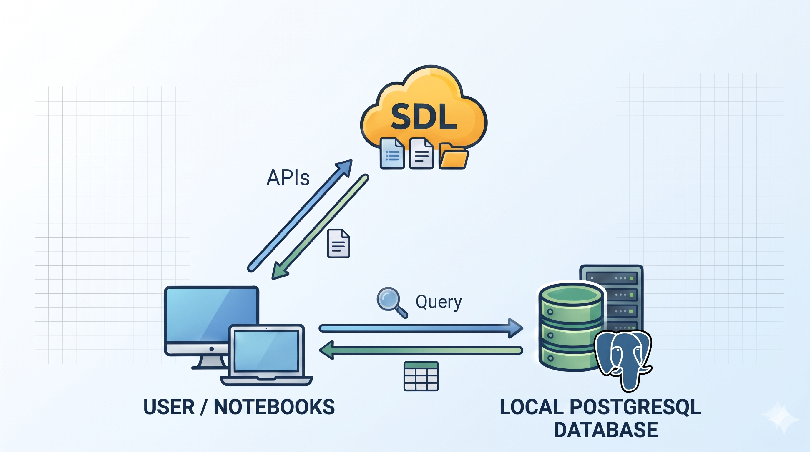

# be-tanti-notebooks

## Description

<p> Official repository of notebooks for Be-TANTI (BEnchmarking and Training dataset for Numerical modelling of Tsunami Inundation): exploratory data analysis, sensitivity analysis, and statistical and machine learning modelling. 

The notebooks are designed to query a local PostgreSQL database containing metadata included in the experiment and use the APIs provided by the Simulation Data Lake (SDL) to download from there the simulation files required for the analysis.

<p align="center">
  
</p>

The repository is organized as follows:
  - the foloder *notebooks* contains several python projects. For each project we provide a SQL query and a jupyter notebook to run it.
  - the folder *config* contains the configuration file of the database where to store the metadata schema (*database.ini*)
  - folder *docs* contains additional material about metadata schema
  - the folder *sample_data* contains a sample dataset with data of few simlations to test notebooks locally
  - the file *requirements.txt* contains the list of required python modules
</p>


## Requirements

Make sure you have the following prerequisites in place before proceeding:
 - Docker
 - GMT≥6
 - Python≥3.12 (ideally with conda)
 - credential to access Cineca's Simulation Data Lake (SDL) portal
 - A PostgreSQL GUI client (optional)


 ## Setup

The Experiment datataset, including *Metadata Schema* and *Simulation Data*, is available on Cineca's Simulation Data Lake (SDL) at the following URL: 

[https://sdl.hpc.cineca.it/app/experiments/207/versions/1.0.0/summary](https://sdl.hpc.cineca.it/app/experiments/207/versions/1.0.0/summary)

### Access to Simulation Data Lake (SDL)

In order to access the SDL we use the Simulation Datalake Control *sdlctl* which provides a command like interface (CLI) and a Python SDK (*pysdl*) that allows you to interact with the SDL programmatically in Python applications. We refer to the [official documentation](https://sdlctl.readthedocs.io/latest/) for a cohemprensive description of this tool.

First create a conda Python environment and install the *sdlctl*. From the conda virtual environment:
```
conda create -n myenv python=3.12
pip install sdlctl --index-url https://gitlab.hpc.cineca.it/api/v4/projects/1647/packages/pypi/simple
```

> **NOTE**
> To upgrade the sdlctl package to the lat version, from the virtual environment runs:
> ```
> pip install sdlctl -U --index-url https://gitlab.hpc.cineca.it/api/v4/projects/1647/packages/pypi/simple
> ```

Next, one should authenticate on SDL by running the command
```
> sdlctl setenv dev
> sdlctl user login
```
and inserting the credential. 

You can check the user status by running:
```
sdlctl user status
```


### Create PostgreSQL database for medataschema with Docker

First, one has to download the dump file of metadata schema from SDL. 

Navigate to the [eperiment](https://sdl.hpc.cineca.it/app/experiments/207/versions/1.0.0/summary) in the SDL portal
  1. navigate to the dump file (*./metadata/backup_file_ct_sr_minidb.dump*)
  2. click the "Download" botton, the select 'Download Files' in the pop-up window
  3. choose the local path where to save the folder ([/path/to/backup_file_ct_sr_minidb.dump])

Alternatevely one can download the file using the CLI, run the command:
```
    > sdlctl file download -id 207 --filepath CT-SR_M100/exp_metadata/exp_metadata_db.dump
```
using the last version of the experiment and set as output the full path (including the name) where to download the file locally ([/path/to/exp_metadata_db.dump]).

Next, we can restore the metadataschema in the postgreSQL:
  1. starts a PostgreSQL database with PostGIS in a Docker container
     ```
     > docker run -p 5409:5432 --rm --name ct-sr-db-postgres -e POSTGRES_PASSWORD=postgres -d postgis/postgis
     ```
  2. copy the backup file into the Docker container:
     ```
     > docker cp [/path/to/exp_metadata_db.dump] ct-sr-db-postgres:/tmp/exp_metadata_db.dump
     ```
  3. Access the container as postgres user and restore the DB from the dump file:
     ```
     > docker exec -u postgres -it ct-sr-db-postgres bash

     > pg_restore -U postgres -C -d postgres /tmp/exp_metadata_db.dump

> **Note**  
> Make sure that the configuration file *config/database.ini* contains the same options used in the above steps.
> ```
> [postgresql]
> host=localhost
> database=ct_sr_db
> user=postgres
> password=postgres
> ```

Eventually one can connect to the database using a Postgres GUI management tool to test queries directly on the database.

Alternatively, one can restore the PostgreSQL database using Singularity, check [here](#Create-PostgreSQL-database-with-Singularity) for details.


## Usage

Clone the repository locally:

```bash
git clone git@gitlab.rm.ingv.it:cat/dataset-catania-siracusa.git
```

Activate the virtual environment and install all the python dependencies listed in *./requirements.txt*

```bash
> cd dataset-catania-siracusa
> pip install -r requirements.txt
```

Install also *python-graphviz* and *pygmt* packages using conda
```bash
> conda install -c conda-forge python-graphviz
> conda install -c conda-forge pygmt
```

Run the desidered notebook. Inside the notebooks one can specify the following input variables:
  - *path_conf_file*: path of the database configuration file (default one, *./config/database.ini*)
  - *path_tmp_download*: path where temporary store the files accessed by SDL's API. By default, the notebooks use the project folders *./sample_data/download_tmp/* which is not synchronized in GIT.
Please check they are correctly defined. 

> **NOTE**
> The notebooks use the SDL API to download the required data from the Simulation Data Lake. However, if you prefer to download the full dataset in advance, or already have it locally, they can be easily adapted to access the data locally.


### Run Notebook 1

The notebook uses metadata schema stored in the database to create a graph representing the structure of experiment workflow as well as the execution of a single Simulatuon Runs. 

To run the notebook use should just specify the path of the database configuration file (*path_conf_file*) as well as the number of simulation runs (*num_simulation_runs*) to be visualized.


### Run Notebook 2

This notebook shows how to select datasets by using their geospatial attributes and retrieve corresponding files via the Python SDK (pysdl) using the SDL API.

To run the notebook, one should specify the path of the database configuration file (*path_conf_file*) as well as the bounding box *(min_lon, min_lat, max_lon, max_lat)* of the geographical region of interest.
To use the SDL API, one needs an SDL account and must be logged in. The datasets retrieved from the SDL are stored under the path *path_tmp_download*.

Alternatively, if the experiment files have already been downloaded, one can specify the dataset path (*path_experiment_dataset*) to directly open the files locally.


### Run Notebook 3

In this notebook we explore the simulation run parameters contained in the metadata schema and show how to obtain aggregate views of the simulated scenarios: geographical location of the events, distribution of parameters of scenarios, etc. 
Since the notebook uses just metadata, to run it one only needs to specify the path of the database configuration file (*path_conf_file*).


### Run Notebook 4

This notebook implements a what-if analysis, allowing one to select scenarios by specifying simulation run parameters, compute the flow depth from the downloaded numerical simulation results, and show the corresponding inundation maps.

To run the notebook, one should specify the path to the database configuration file (*path_conf_file*) and the value ranges for the simulation run parameters.
The datasets retrieved from the SDL are stored under the path *path_tmp_download*.

Alternatively, if the experiment files have already been downloaded, one can specify the dataset path (*path_experiment_dataset*) to directly open the files locally.


### Run Notebook 5

This notebook implements a sensitivity analysis of simulation runs with respect to the Manning coefficient. In particular, it plots and compares the different cumulative inundation areas at a specific site (Catania or Siracusa) obtained by varying the Manning coefficient.

To run the notebook, one should specify the path to the database configuration file (*path_conf_file*), the range values of the simulation run parameters to select the desired scenario and the site of interest. The datasets retrieved from the SDL are stored under the path *path_tmp_download*.

Alternatively, if the experiment files have already been downloaded, one can specify the dataset path (*path_experiment_dataset*) to directly open the files locally.


### Run Notebook 6

We provide two notebooks:
   1. *create_ml_emulator.ipynb*: used to train an ML inundation emulator at a specific site (Catania or Siracusa) over a subset of simulation data.
   2. *test_ml_emulator.ipynb*: used to evaluate the performance of previously trained ML inundation emulators.

To run the first notebook, one should specify the path to the database configuration file (*path_conf_file*), the path where to store datasets downloaded with the API (*path_tmp_download*), and the path where to save the results of the ML models. Additionally, by changing the query parameters, one can decide which scenarios to include in the training and select the target site (Catania or Siracusa) of the emulator.

Since training and test sets can be large and one may want to train multiple models to compare them, the notebook optimizes download performance by skipping files already downloaded and resuming if interrupted. For this reason, the second notebook (*test_ml_emulator.ipynb*) is dedicated to visualizing and comparing the results of these trained models.


### Run Notebook 7

In this notebook we implements the Important Stratified Sampling technicques: given a site (Catania or Siracusa) we select a subset of representative scenarios that approximate the hazard curve.
To run the notebook use should just specify the path of the database configuration file (*path_conf_file*) as it makes use of metadata available in the experiment.